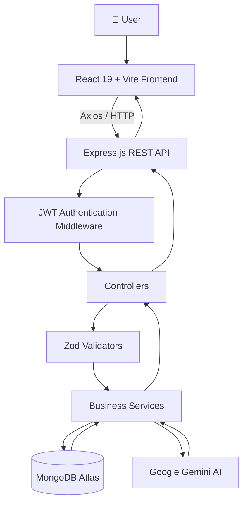
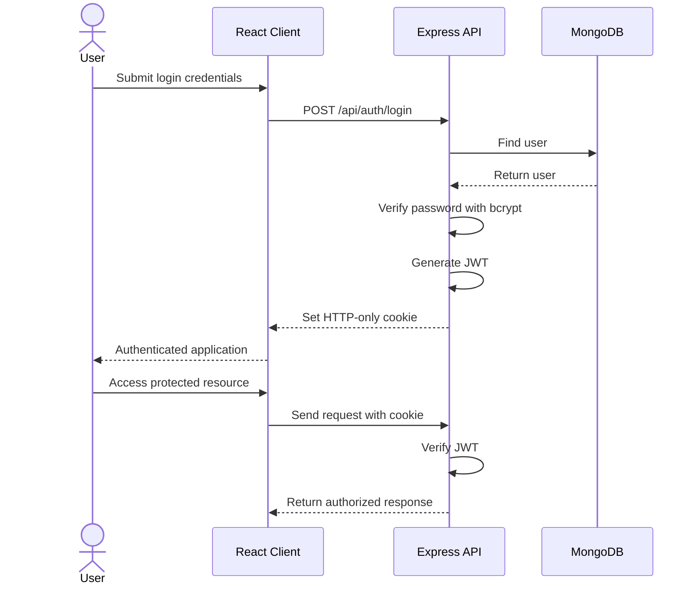

 <div align="center">

# SalesPilot AI

### Manage leads. Build relationships. Accelerate sales with AI.

SalesPilot AI is a full-stack CRM platform designed to simplify sales management through centralized lead tracking, customer relationship management, sales pipeline monitoring, and AI-powered sales intelligence.

Built with React, Node.js, Express, MongoDB, and Google Gemini AI, it brings essential sales workflows together in one modern and intuitive application.

[**Live Demo**](https://sales-pilot-client.vercel.app/) · [**Backend API**](https://sales-pilot-sand.vercel.app/) · [**API Health**](https://sales-pilot-sand.vercel.app/api/health)

<br />


<br />


<br />


</div>

---

## 📑 Table of Contents

- [Overview](#overview)
- [Screenshots](#screenshots)
- [Features](#features)
- [How It Works](#how-it-works)
- [Technology Stack](#technology-stack)
- [Getting Started](#getting-started)
- [Environment Variables](#environment-variables)
- [Database Setup](#database-setup)
- [Available Commands](#available-commands)
- [Project Structure](#project-structure)
- [AI Integration](#ai-integration)
- [Security Considerations](#security-considerations)
- [Roadmap](#roadmap)
- [Contributing](#contributing)
- [Author](#author)

---

## Overview

Managing sales leads, customer relationships, and follow-up activities across different tools can become complicated.

SalesPilot AI provides a centralized workspace where users can manage their sales operations and make better-informed decisions with AI assistance.

The application brings essential sales management workflows together:

- Manage leads with CRUD operations, search, filters, and sorting.
- Organize customer and business contacts.
- Track sales opportunities through pipeline stages.
- Create and manage notes and tasks.
- Monitor sales performance through dashboard analytics.
- Generate personalized sales emails using Google Gemini AI.
- Generate AI-powered insights to support sales decisions.
- Secure user authentication with JWT and HTTP-only cookies.

| | |
|---|---|
| **Live Application** | [SalesPilot AI](https://sales-pilot-client.vercel.app/) |
| **Backend API** | [SalesPilot API](https://sales-pilot-sand.vercel.app/) |
| **API Health** | [Health Check](https://sales-pilot-sand.vercel.app/api/health) |
| **GitHub Profile** | [Vishwak-Tech](https://github.com/Vishwak-Tech) |

---

## Screenshots

Explore the SalesPilot AI interface and its core CRM workflows.

<table>
  <tr>
    <td align="center" width="50%">
      <strong>Dashboard</strong><br /><br />
      
    </td>
    <td align="center" width="50%">
      <strong>Lead Management</strong><br /><br />
      
    </td>
  </tr>
  <tr>
    <td align="center" width="50%">
      <strong>Sales Pipeline</strong><br /><br />
      
    </td>
    <td align="center" width="50%">
      <strong>Contact Management</strong><br /><br />
      
    </td>
  </tr>
  <tr>
    <td align="center" width="50%">
      <strong>Tasks & Follow-ups</strong><br /><br />
      
    </td>
    <td align="center" width="50%">
      <strong>AI Email Generation</strong><br /><br />
      
    </td>
  </tr>
  <tr>
    <td align="center" colspan="2">
      <strong>AI-Powered Sales Insights</strong><br /><br />
      
    </td>
  </tr>
</table>

---

## Features

### 🔐 Authentication & Authorization

- User registration and login.
- Secure password hashing using bcryptjs.
- JWT-based authentication.
- HTTP-only authentication cookies.
- Protected frontend routes.
- Backend authentication middleware.
- Persistent authentication state.

### 👥 Lead Management

- Create, view, update, and delete leads.
- Search leads in real time.
- Filter leads by stage, priority, and source.
- Sort lead records.
- Bulk delete functionality.
- Export lead records to CSV.
- Switch between table and card views.
- View detailed lead information through an interactive drawer.
- Access AI-assisted lead functionality.

### 📊 Dashboard & Sales Pipeline

- Centralized sales dashboard.
- Sales performance statistics.
- Visual sales pipeline.
- Track lead stages and progress.
- Monitor sales activities and opportunities.

### 📇 Contact Management

- Create and manage customer contacts.
- Maintain organized contact information.
- Access customer records from the CRM.

### 📝 Notes & Tasks

- Create, update, and delete notes.
- Organize sales-related tasks.
- Track task progress.
- Maintain important customer and sales information.

### 🤖 AI-Powered Sales Intelligence

Integrated with Google Gemini AI to support sales productivity and decision-making.

| AI Feature | Description |
|---|---|
| AI Email Generation | Generate personalized sales emails based on lead context, purpose, and tone. |
| AI Sales Insights | Generate AI-assisted insights to support sales decisions. |
| Lead AI Services | Provide AI-powered lead-related functionality. |

### 🎨 User Experience

- Modern Graphite and Emerald-inspired interface.
- Reusable UI component architecture.
- Responsive application layouts.
- Interactive dialogs and drawers.
- Loading skeletons and empty states.
- Confirmation dialogs for important actions.
- Centralized API communication and error handling.

---

## How It Works

SalesPilot AI connects a React frontend, Express backend, MongoDB database, and Google Gemini AI services.

### Application Workflow

1. **Authenticate:** Users register or log in securely.
2. **Manage:** Create and organize leads, contacts, notes, and tasks.
3. **Track:** Monitor sales opportunities through the pipeline.
4. **Analyze:** Review dashboard statistics and sales information.
5. **Generate:** Use Google Gemini to generate sales emails and insights.
6. **Improve:** Use centralized customer and sales information to manage follow-ups.

### System Architecture



### Authentication Flow



---

## Technology Stack

| Area | Technology | Purpose |
|---|---|---|
| Frontend Framework | React 19 | Component-based user interface |
| Language | JavaScript (ES Modules) | Application logic |
| Build Tool | Vite | Development and production builds |
| Styling | Tailwind CSS v4 | Responsive UI styling |
| HTTP Client | Axios | API communication |
| State Management | React Context API | Authentication state |
| Backend Runtime | Node.js | Server-side JavaScript |
| Backend Framework | Express.js | REST API development |
| Database | MongoDB | Data persistence |
| ODM | Mongoose | MongoDB object modeling |
| Authentication | JSON Web Token | User authentication |
| Password Security | bcryptjs | Password hashing |
| Validation | Zod | Request validation |
| AI Integration | Google Gemini | AI-powered sales features |
| AI SDK | Google GenAI SDK | Gemini API communication |
| Logging | Morgan | HTTP request logging |
| Deployment | Vercel | Application hosting |
| Database Hosting | MongoDB Atlas | Cloud database |

---

## Getting Started

Follow these steps to run SalesPilot AI locally.

### Prerequisites

Make sure you have the following installed or configured:

- [Node.js](https://nodejs.org/)
- npm
- [Git](https://git-scm.com/)
- A MongoDB local instance or [MongoDB Atlas](https://www.mongodb.com/atlas)
- A [Google Gemini API key](https://aistudio.google.com/apikey)

### 1. Clone the Repository

```bash
git clone <YOUR_GITHUB_REPOSITORY_URL>
cd SalesPilot
```

> Replace `<YOUR_GITHUB_REPOSITORY_URL>` with your actual repository URL.

### 2. Install Frontend Dependencies

```bash
cd Client
npm install
```

### 3. Install Backend Dependencies

Open another terminal from the project root:

```bash
cd server
npm install
```

### 4. Configure Environment Variables

Create the following environment files:

```text
Client/.env
server/.env
```

Configure them using the [Environment Variables](#environment-variables) section.

### 5. Start the Backend

From the `server` directory:

```bash
npm run dev
```

The backend will start on:

```text
http://localhost:8000
```

### 6. Start the Frontend

From the `Client` directory:

```bash
npm run dev
```

Open the application in your browser:

```text
http://localhost:5173
```

---

## Environment Variables

### Frontend — `Client/.env`

```env
VITE_API_URL=http://localhost:8000/api
```

### Backend — `server/.env`

```env
NODE_ENV=development
PORT=8000

CLIENT_URL=http://localhost:5173

MONGO_URI=your_mongodb_connection_string

JWT_SECRET=your_secure_jwt_secret_at_least_32_characters
JWT_EXPIRES_IN=7d

GEMINI_API_KEY=your_google_gemini_api_key
GEMINI_MODEL=gemini-2.5-flash
```

### Environment Variable Reference

| Variable | Application | Description |
|---|---|---|
| `VITE_API_URL` | Frontend | Backend API base URL |
| `NODE_ENV` | Backend | Application environment |
| `PORT` | Backend | Server port |
| `CLIENT_URL` | Backend | Allowed frontend origin for CORS |
| `MONGO_URI` | Backend | MongoDB connection string |
| `JWT_SECRET` | Backend | Secret used to sign JWTs |
| `JWT_EXPIRES_IN` | Backend | JWT expiration duration |
| `GEMINI_API_KEY` | Backend | Google Gemini API key |
| `GEMINI_MODEL` | Backend | Gemini model identifier |

> [!WARNING]
> Never commit `.env` files, database credentials, JWT secrets, or AI API keys. Variables prefixed with `VITE_` are exposed to frontend code and must never contain private secrets.

---

## Database Setup

SalesPilot AI uses MongoDB with Mongoose for data modeling and database operations.

### MongoDB Configuration

1. Create a MongoDB Atlas account or use a local MongoDB instance.
2. Create a database for SalesPilot AI.
3. Configure database access credentials.
4. Add the appropriate network access rules.
5. Copy your MongoDB connection string.
6. Add it to `server/.env` as `MONGO_URI`.

### Database Models

The backend includes the following Mongoose models:

| Model | Responsibility |
|---|---|
| `User` | User accounts and authentication |
| `Lead` | Sales lead information |
| `Contact` | Customer and business contacts |
| `Note` | Sales-related notes |
| `Task` | Task and follow-up management |
| `Activity` | Activity records |

### Seed Data

The backend includes a `seed.js` script.

Run it from the `server` directory:

```bash
npm run seed
```

> [!CAUTION]
> Review the seed script before executing it, particularly when connected to a database containing real data.

---

## Available Commands

### Frontend Commands

Run these commands from the `Client` directory.

| Command | Description |
|---|---|
| `npm install` | Install frontend dependencies |
| `npm run dev` | Start the Vite development server |

### Backend Commands

Run these commands from the `server` directory.

| Command | Description |
|---|---|
| `npm install` | Install backend dependencies |
| `npm run dev` | Start the backend with Nodemon |
| `npm start` | Start the backend server |
| `npm run seed` | Execute the database seed script |

### API Health Check

Verify that the backend is running:

```http
GET /api/health
```

Local URL:

```text
http://localhost:8000/api/health
```

Example local development response:

```json
{
  "success": true,
  "message": "SalesPilot API is running",
  "environment": "development"
}
```

### API Route Prefixes

| Route Prefix | Responsibility |
|---|---|
| `/api/auth` | Authentication |
| `/api/leads` | Lead management |
| `/api/contacts` | Contact management |
| `/api/notes` | Notes management |
| `/api/tasks` | Task management |
| `/api/ai` | AI-powered functionality |
| `/api/analytics` | Dashboard analytics |

---

## Project Structure

SalesPilot AI follows a modular architecture with separate frontend and backend applications.

```text
SalesPilot/
│
├── Client/
│   │
│   ├── public/
│   │   ├── Emerald Growth Chart Logo.png
│   │   ├── favicon.png
│   │   ├── favicon.svg
│   │   ├── icons.svg
│   │   ├── logo.png
│   │   └── og-image.png
│   │
│   ├── src/
│   │   │
│   │   ├── assets/
│   │   │   ├── hero.png
│   │   │   ├── react.svg
│   │   │   └── vite.svg
│   │   │
│   │   ├── components/
│   │   │   ├── ai/
│   │   │   │   ├── AiEmailDialog.jsx
│   │   │   │   └── AiInsightsCard.jsx
│   │   │   │
│   │   │   ├── common/
│   │   │   │   ├── ConfirmDialog.jsx
│   │   │   │   ├── EmptyState.jsx
│   │   │   │   ├── PageHeader.jsx
│   │   │   │   └── StatCard.jsx
│   │   │   │
│   │   │   ├── dashboard/
│   │   │   │   └── HeroCard.jsx
│   │   │   │
│   │   │   ├── layout/
│   │   │   │   ├── AppLayout.jsx
│   │   │   │   ├── IconRail.jsx
│   │   │   │   ├── ProtectedRoute.jsx
│   │   │   │   ├── Sidebar.jsx
│   │   │   │   ├── Topbar.jsx
│   │   │   │   └── TopNav.jsx
│   │   │   │
│   │   │   ├── leads/
│   │   │   │   ├── LeadDrawer.jsx
│   │   │   │   └── LeadFormDialog.jsx
│   │   │   │
│   │   │   └── ui/
│   │   │       ├── Avatar.jsx
│   │   │       ├── Badge.jsx
│   │   │       ├── Button.jsx
│   │   │       ├── Card.jsx
│   │   │       ├── Dialog.jsx
│   │   │       ├── Dropdown.jsx
│   │   │       ├── IconButton.jsx
│   │   │       ├── Input.jsx
│   │   │       ├── Skeleton.jsx
│   │   │       ├── Tabs.jsx
│   │   │       └── index.js
│   │   │
│   │   ├── context/
│   │   │   └── AuthContext.jsx
│   │   │
│   │   ├── lib/
│   │   │   ├── api.js
│   │   │   ├── constants.js
│   │   │   ├── format.js
│   │   │   ├── mockData.js
│   │   │   ├── services.js
│   │   │   └── utils.js
│   │   │
│   │   ├── pages/
│   │   │   ├── auth/
│   │   │   │   ├── AuthShell.jsx
│   │   │   │   ├── Login.jsx
│   │   │   │   └── Register.jsx
│   │   │   │
│   │   │   ├── Contacts.jsx
│   │   │   ├── Dashboard.jsx
│   │   │   ├── Leads.jsx
│   │   │   ├── Notes.jsx
│   │   │   ├── Pipeline.jsx
│   │   │   ├── Settings.jsx
│   │   │   └── Tasks.jsx
│   │   │
│   │   ├── App.css
│   │   ├── App.jsx
│   │   ├── index.css
│   │   └── main.jsx
│   │
│   ├── .env.example
│   ├── .gitignore
│   ├── eslint.config.js
│   ├── index.html
│   ├── package.json
│   ├── package-lock.json
│   ├── README.md
│   └── vite.config.js
│
├── server/
│   │
│   ├── config/
│   │   ├── db.js
│   │   └── env.js
│   │
│   ├── controllers/
│   │   ├── ai.controller.js
│   │   ├── analytics.controller.js
│   │   ├── auth.controller.js
│   │   ├── contact.controller.js
│   │   ├── lead.controller.js
│   │   ├── note.controller.js
│   │   └── task.controller.js
│   │
│   ├── middleware/
│   │   ├── auth.middleware.js
│   │   └── error.middleware.js
│   │
│   ├── models/
│   │   ├── Activity.js
│   │   ├── Contact.js
│   │   ├── Lead.js
│   │   ├── Note.js
│   │   ├── Task.js
│   │   └── User.js
│   │
│   ├── routes/
│   │   ├── ai.routes.js
│   │   ├── analytics.routes.js
│   │   ├── auth.routes.js
│   │   ├── contact.routes.js
│   │   ├── lead.routes.js
│   │   ├── note.routes.js
│   │   └── task.routes.js
│   │
│   ├── services/
│   │   ├── ai/
│   │   │   ├── email-ai.service.js
│   │   │   ├── insight-ai.service.js
│   │   │   └── lead-ai.service.js
│   │   └── ai.service.js
│   │
│   ├── utils/
│   │   ├── ApiError.js
│   │   ├── asyncHandler.js
│   │   └── generateToken.js
│   │
│   ├── validators/
│   │   ├── ai.validator.js
│   │   ├── auth.validator.js
│   │   ├── contact.validator.js
│   │   ├── lead.validator.js
│   │   ├── note.validator.js
│   │   └── task.validator.js
│   │
│   ├── .gitignore
│   ├── app.js
│   ├── index.js
│   ├── package.json
│   ├── package-lock.json
│   ├── seed.js
│   └── server.js
│
└── README.md
```

### Frontend Architecture

| Directory | Responsibility |
|---|---|
| `components/ai/` | AI email and insights components |
| `components/common/` | Shared application components |
| `components/dashboard/` | Dashboard-specific components |
| `components/layout/` | Layout, navigation, and protected routes |
| `components/leads/` | Lead forms and detail drawer |
| `components/ui/` | Reusable UI component library |
| `context/` | Authentication state |
| `lib/` | API client, services, constants, and utilities |
| `pages/` | Application pages |

### Backend Architecture

| Directory | Responsibility |
|---|---|
| `config/` | Database and environment configuration |
| `controllers/` | HTTP request handling |
| `middleware/` | Authentication and error handling |
| `models/` | MongoDB data models |
| `routes/` | REST API route definitions |
| `services/` | Business logic and integrations |
| `services/ai/` | AI email, insights, and lead services |
| `utils/` | Shared backend utilities |
| `validators/` | Request validation schemas |

---

## AI Integration

SalesPilot AI integrates Google Gemini through the Google GenAI SDK.

AI functionality is organized into dedicated services to keep AI-related logic separate from HTTP request handling.

### AI Service Architecture

```text
AI Request
    │
    ▼
Express AI Route
    │
    ▼
AI Controller
    │
    ▼
AI Service Layer
    │
    ├── Email AI Service
    │
    ├── Insight AI Service
    │
    └── Lead AI Service
    │
    ▼
Google Gemini API
    │
    ▼
Generated AI Response
    │
    ▼
API Response to Frontend
```

### AI Capabilities

| Capability | Description |
|---|---|
| Email Generation | Generate sales emails using lead context, purpose, and tone. |
| Sales Insights | Generate AI-assisted insights for sales workflows. |
| Lead Intelligence | Support lead-related AI functionality. |

The AI service layer helps isolate external AI integration from the main CRM controllers and frontend components.

---

## Security Considerations

SalesPilot AI uses several security mechanisms to protect application access and user information.

| Area | Implementation |
|---|---|
| Password Security | bcryptjs password hashing |
| Authentication | JWT-based authentication |
| Token Storage | HTTP-only cookies |
| Protected Resources | Authentication middleware |
| Request Validation | Zod schemas |
| Database Access | Mongoose models |
| API Communication | Credential-aware CORS configuration |
| Configuration | Environment variables |

### Security Recommendations

- Never commit `.env` files or credentials.
- Keep JWT secrets and Gemini API keys on the backend.
- Validate and sanitize incoming request data.
- Enforce resource ownership checks on protected CRM operations.
- Configure CORS with explicitly trusted frontend origins.
- Use secure cookie settings in production.
- Apply rate limiting to authentication and AI endpoints.
- Monitor API errors and unexpected activity.

---

## Roadmap

### Version 1.1

- [ ] Expand automated unit and integration tests.
- [ ] Improve AI-generated sales insights.
- [ ] Add more advanced analytics.
- [ ] Improve API documentation.
- [ ] Enhance error monitoring and logging.

### Future Improvements

- [ ] Role-based access control.
- [ ] Team collaboration and shared workspaces.
- [ ] Automated email follow-ups.
- [ ] Background jobs for scheduled tasks.
- [ ] Advanced sales forecasting.
- [ ] More AI-powered sales workflows.
- [ ] Performance monitoring and observability.

---

## Contributing

Contributions, bug reports, and suggestions are welcome.

1. Fork the repository.
2. Create a feature branch:

   ```bash
   git checkout -b feature/my-feature
   ```

3. Make your changes and verify the application.
4. Commit your changes:

   ```bash
   git commit -m "feat: add your feature"
   ```

5. Push your branch:

   ```bash
   git push origin feature/my-feature
   ```

6. Open a Pull Request with a clear description of your changes.

---

## Author

**Vishwak Koleti**

Computer Science & Data Analytics Student | IIT Patna

Interested in Full-Stack Development, Backend Engineering, Generative AI, and Software Engineering.

- GitHub: [Vishwak-Tech](https://github.com/Vishwak-Tech)
- LinkedIn: [Connect on LinkedIn](https://www.linkedin.com/in/vishwak-koleti-tech)

### ⭐ Support

If you find SalesPilot AI useful:

- Star the repository.
- Fork the project.
- Report bugs or suggest improvements.

---

<div align="center">

**Built with ❤️ using React, Node.js, Express, MongoDB, and Google Gemini AI.**

*SalesPilot AI — Smarter Sales. Better Relationships. Stronger Growth.*

</div>
